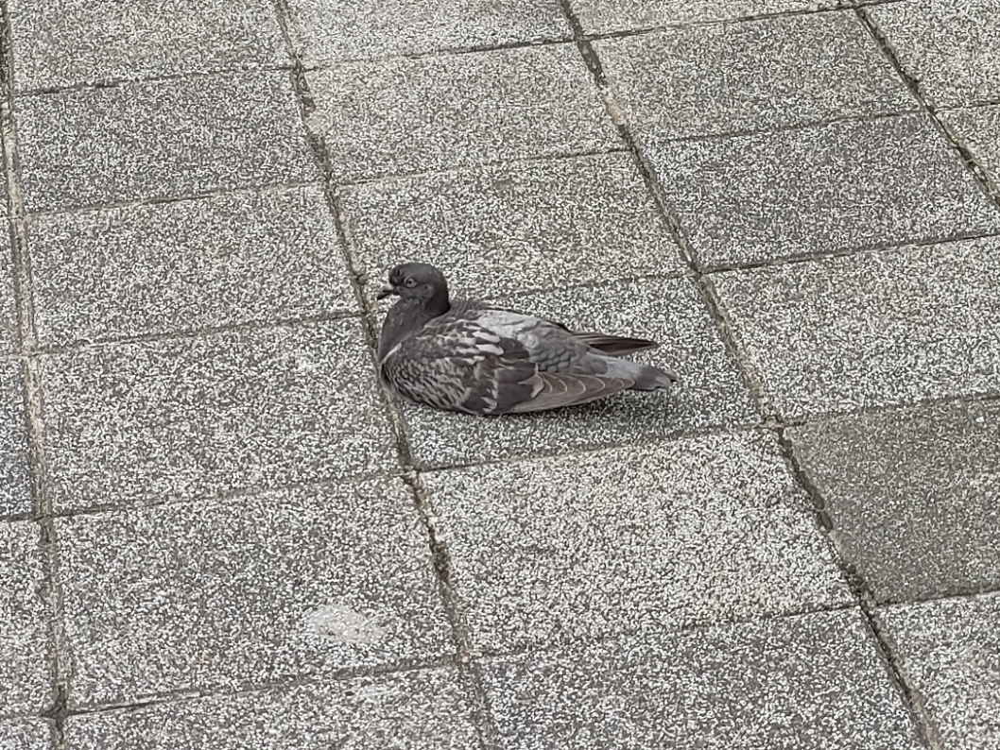

# saiiwake.github.io
# 劉恩佑的個人網頁

 

    

---

## 1. 基本資料

| 項目 | 內容 |
| :--- | :--- |
| **姓名 / Name** | 劉恩佑 |
| **系級 / Department & Year** | 生命科學暨生物科技學系一年級 |
| **學校 / University** | 臺灣海洋大學 |
| **家鄉 / Hometown** | 桃園 |
| **Email** | saiiwakesaki@gmail.com |
| **GitHub** | [saiiwake](https://github.com/saiiwake) |

---

## 2. 關於我 About Me

大家好，我是劉恩佑，目前就讀臺灣海洋大學生命科學暨生物科技學系一年級。我對生命科學、電腦與人工智慧很有興趣。進入大學後，我希望除了學習專業知識之外，也能培養程式設計、資料分析與外語能力，尤其是英文。

---

## 3. 我的興趣 Interests

* 🏀 **運動：** 慢跑
* 🎵 **音樂：** Jpop、二次元樂團
* 🎮 **休閒：** 各種遊戲 (FPS 和手遊)、動漫、直笛
* 💻 **學習：** Python、AI、生物資訊

---

## 4. 我的學習與技能 Skills

| 技能 | 目前程度 | 我會做什麼 |
| :--- | :--- | :--- |
| **Python** | 初學 | 變數、if、for、function |
| **GitHub** | 初學 | 建立 repository、commit、push |
| **英文** | 初學 | 閱讀英文教材 |

---

## 5. 我做過的小作品 Projects

### Project 1｜我的第一個 Python 程式
這是我在課堂中完成的第一個 Python 小作品。我學會如何使用變數、輸入資料，以及將結果顯示在畫面上。
* **GitHub 連結：** [點此查看專案](https://github.com/your-account/your-project)

### Project 2｜（自行填寫）
* **作品內容：** __________________________________________________
* **GitHub 連結：** ________________________________________________

---

## 6. 我的學習目標 Goals

* [ ] 學會 Python 基礎程式設計。
* [ ] 學會使用 Git 與 GitHub 管理自己的作品。
* [ ] 建立自己的第一個個人網站。
* [ ] 未來能將程式設計應用在自己的專業領域。

---

## 7. 聯絡我 Contact

* **Email：** student@example.com
* **GitHub：** [your-account](https://github.com/your-account)
* **其他公開連結：** LinkedIn / 個人作品集 / 社群網站 *(選填)*

---

## 8. 給未來的自己 A Note to My Future Self

> 希望一年後回來看這個網頁時，我已經學會更多程式設計技巧，也完成更多自己的作品。
> 
> *Of course, to the Danger Zone。*
